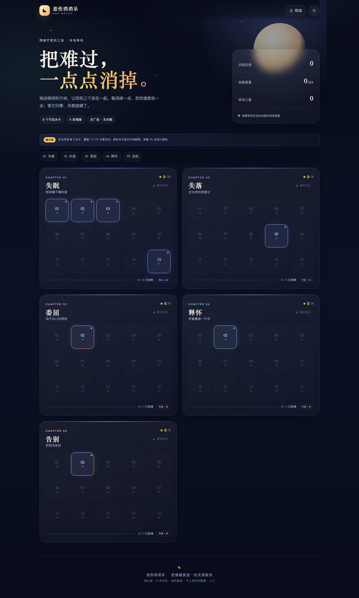

# 悲伤消消乐 · 展示版

> 一款情绪疗愈向的三消小游戏。把悲伤值一点点消掉，天就放晴了。
>
> 展示版开放 **8 个可玩关卡**，覆盖 T1–T5 全部目标类型与章末日记；其余关卡保留在 75 关地图中，显示为“待解锁”。



## 快速运行

零构建、零运行时依赖、无 CDN、无后端。只需要一个静态文件服务器：

```bash
cd 悲伤消消乐-软件工程课程设计
python3 -m http.server 8770 --bind 127.0.0.1 --directory app
```

打开 <http://127.0.0.1:8770>。

也可以使用 npm 脚本：

```bash
npm start          # 等价于上面的 python3 静态服务器
```

> 直接双击 `app/index.html` 在部分浏览器中受 ES Module 的同源限制，建议用静态服务器。

## 展示版开放关卡

| 关卡 | 章节 | 目标 | 展示点 |
| --- | --- | --- | --- |
| C1-L01 长夜 | 失眠 | T1 疗愈达标 | 新手内嵌提示、2 层情绪、完整一局 |
| C1-L02 数羊 | 失眠 | T1 疗愈达标 | 连续消除与连锁 |
| C1-L03 天花板 | 失眠 | T1 疗愈达标 | 三星与剩余步数 |
| C1-L15 天亮之前 | 失眠 | T1 疗愈达标 | 章末关、章末情绪日记、三星门槛 |
| C2-L09 无人接听 | 失落 | T1 + T2 共鸣收集 | 收集 14 个天青水滴 |
| C3-L02 眼泪的重量 | 委屈 | T1 + T3 清散阴云 | 阴云生成、相邻消除命中 3 次消散 |
| C4-L02 原谅 | 释怀 | T1 + T4 连锁挑战 | 达成 3 连锁 |
| C5-L02 站台的风 | 告别 | T1 + T5 精准放晴 | 放晴时剩余步数 ≥20% |

其余 67 关保留关卡编号、名称、S0、步数、情绪层与目标配置，在地图上以“待解锁”呈现。这样既保留 75 关设计结构，又不把展示版做成 75 关的完整内容生产。

## 已实现的功能

| 需求族 | 实现 |
| --- | --- |
| FR-LV-01～04 | 悲伤值、疗愈进度、阴云机制、清零通关；公式严格按需求实现 |
| FR-LV-05～07 | 5 章 × 15 关地图、章内脉冲节奏标记、T1–T5 目标类型、章末日记 |
| FR-LV-08 | 每步稳定结算后写入 `localStorage`，刷新/切后台/重开页面可恢复同一盘面 |
| FR-LV-09～10 | 40–90 步预算；6 分钟硬上限；情绪层调和数值；模拟记录留档 |
| FR-LV-11～15 | 1/2/3 星、无限重试、连续失败 3 次温柔模式、无解自动重排、章节解锁规则 |
| FR-SD-01～05 | 唯一分数“共鸣值”、基础/连锁/阴云/剩余步数计分、历史最高分汇总、防刷分 |
| FR-IT-01～05 | 深呼吸 / 拥抱 / 共鸣 / 换气；库存上限 5、单关上限 2；道具消除完整计分 |
| FR-SH-01～09 | 1080×1920 本地 Canvas 成绩图、8 条/章情绪文案、保存/复制/系统分享回退、无奖励、无隐私字段 |
| FR-AV-01～03 | WebAudio 合成音效与背景垫音、分别开关、动画时长预算 |
| NFR-01～12 | 零外部请求、离线可玩、响应式、44px 热区（390px 宽起）、颜色+形状双重编码、低颜色模式 |
| FR-LB-01～03 | 本期无排行榜、无账号、无联网请求 |

## 项目结构

```
悲伤消消乐-软件工程课程设计/
├── app/                       # 可运行展示版
│   ├── index.html
│   ├── css/style.css
│   └── js/
│       ├── core/              # 领域层：规则/棋盘/关卡/存档/流程（不依赖 DOM）
│       │   ├── board.js
│       │   ├── game.js
│       │   ├── levels.js
│       │   ├── profile.js
│       │   ├── rules.js
│       │   ├── rng.js
│       │   └── tiles.js
│       ├── ui/                # 表现层：棋盘视图/分享图/图标/DOM 工具
│       ├── audio.js
│       └── main.js
├── docs/                      # 需求、设计、基线、AI 记录、关键结论、实现说明
├── scripts/simulate.mjs       # 蒙特卡洛模拟（8 个展示关 × N 局）
├── tests/rules.test.mjs       # 18 项领域/存档/流程单元测试
├── tests/browser.cjs          # 18 项 Playwright 浏览器验收
└── evidence/                  # 截图、测试输出、模拟记录
```

## 测试与证据

```bash
npm test                 # node:test 单元测试（18 项）
npm run simulate         # 8 关 × 200 局蒙特卡洛，写入 evidence/
npm run test:browser     # Playwright 浏览器验收（18 项；需先安装 playwright）
```

本机结果：

- 单元测试：**18 / 18 通过**。
- 浏览器验收：**B01–B18 全部通过**，运行期无外部域请求、无未捕获异常。
- 蒙特卡洛：8 个展示关 × 200 局 = **1600 局**，通关率 99.6%，通关局三星率 54.6%。展示版刻意降低了门槛，便于在几分钟内看完整流程；完整 75 关的难度曲线仍需内容阶段调参。

证据文件：

- [测试输出](evidence/test-output.txt)
- [浏览器验收 JSON](evidence/browser-tests.json)
- [模拟汇总](evidence/simulation-summary.md) / [逐关数据](evidence/simulation.json)
- [实现与验收说明](docs/06-实现与验收说明.md)

## 关键设计说明

### 1. 情绪层：为什么一关有 2–3 层

需求同时要求「S0 = 40–100」与「单关 40–90 步」，但按 FR-LV-01 的减免公式，40–100 点悲伤值通常在 9–24 步内就会被清空，两个约束无法同时成立。

展示版的处理：把一关拆成 2–3 个**情绪层**，每层 S0 仍在 40–100，层间不清空步数、分数、道具次数和阴云；悲伤值归零后进入下一层，全部层归零才算 T1 达标。公式本身完全不变。详见 `docs/06-实现与验收说明.md`。

### 2. 展示版与完整版

- 75 关的配置数据仍然保留，地图可见，但只开放 8 关；其余显示“待解锁”。
- 需求文档中的“完整 75 关”仍是产品目标；展示版优先保证可玩、可验收、可演示。
- 任务一/任务二的文档基线未被修改；实现说明单独记录范围与口径差异。

### 3. 技术选型

展示版采用**零依赖 HTML5 + CSS + 原生 ES Modules**，而不是 Cocos Creator 3.8.8 工程，原因：

- 当前环境没有 Cocos Creator 编辑器，无法构建/验证 Cocos 产物；
- 领域层（`app/js/core/`）完全与 DOM/Cocos 解耦，可以 1:1 映射到设计文档中的 `BoardEngine / RuleEngine / ScoreService / ItemService / ProgressService / SaveRepository`；
- 纯静态实现可以立即运行、做单元测试与 Playwright 验收，适合课程展示。

这是与设计文档 C-07 / NFR-12 的已知偏差，详见实现说明的“已知偏差”一节。

## 文档索引

| 文档 | 内容 |
| --- | --- |
| [01-需求分析文档](docs/01-需求分析文档.md) | 任务一需求基线 v1.0（仅修复 §8.2 的格式损坏） |
| [02-软件设计文档](docs/02-软件设计文档.md) | 任务二架构与系统设计 v1.0 |
| [03-需求基线说明](docs/03-需求基线说明.md) | 任务二需求基线对照 |
| [04-AI协作记录](docs/04-AI协作记录.md) | 五轮需求协作与人工核实记录 |
| [05-关键结论验证](docs/05-关键结论验证.md) | 关键结论及依据/假设分级 |
| [06-实现与验收说明](docs/06-实现与验收说明.md) | 展示版实现口径、需求对照、验收证据、已知偏差 |

## 操作提示

- 点选两个相邻方块，或直接拖动一个方块到相邻位置。
- 每关最多用 2 次道具；道具只作用于盘面，靠消除间接减悲伤值。
- 连续失败 3 次会开启温柔模式：+10 步，星级上限 2 星。
- 单局 6 分钟硬上限；切后台会暂停计时并保存。
- 「留下这一刻」生成 1080×1920 的本地分享图，不绑定任何奖励。

---

作者：袁弃心 U202414583 · 软件工程课程设计 · 2026-11
