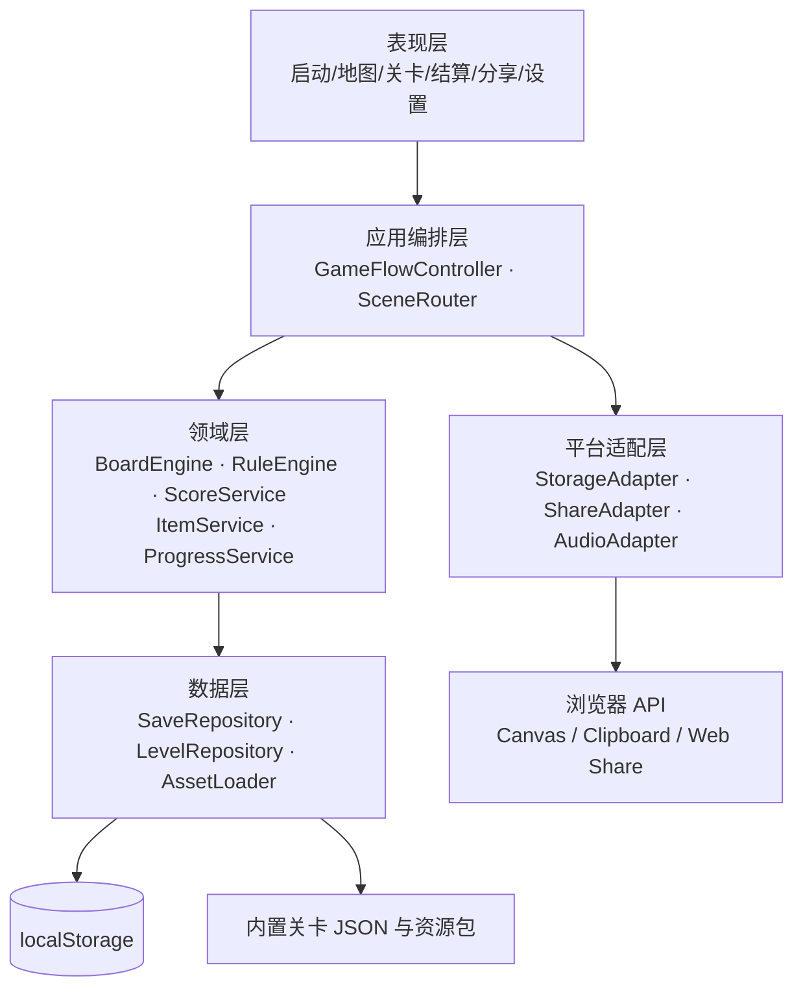
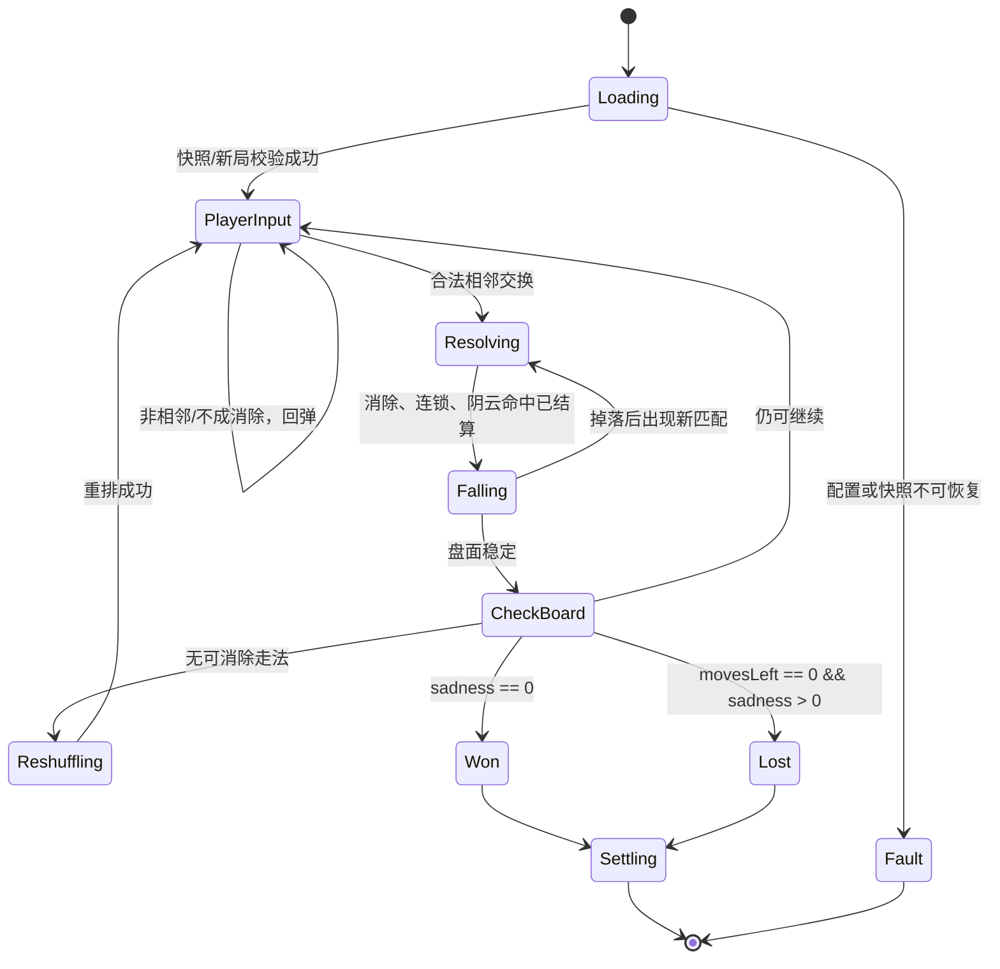
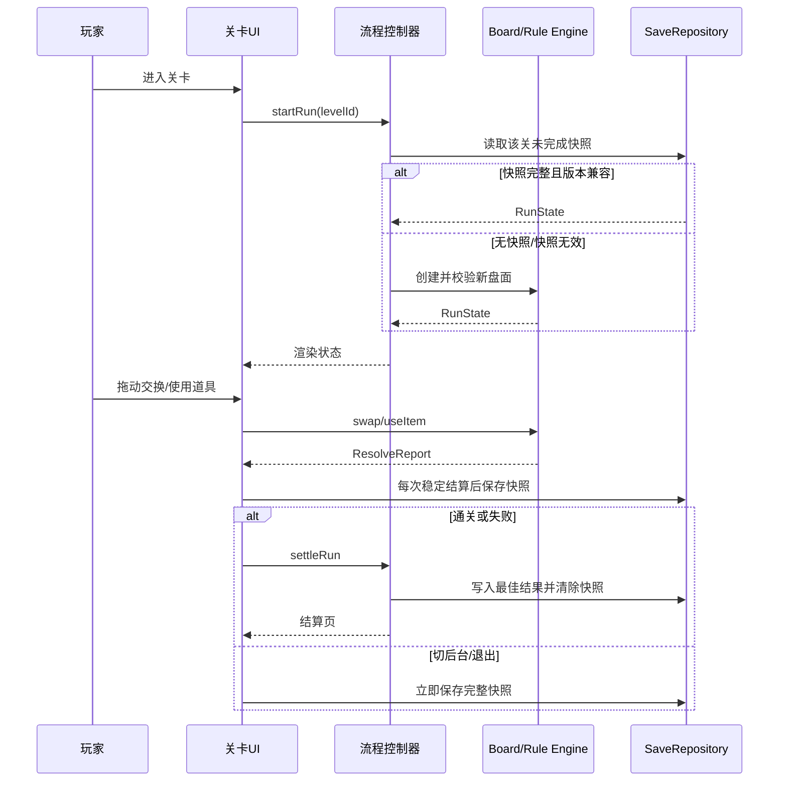

# 悲伤消消乐｜软件设计文档（架构设计与系统设计）

> 版本：v1.0　日期：2026-11-01　设计对象：Cocos Creator 3.8.8 网页端关卡制单机游戏
>
> 需求基线：任务一《需求分析文档》v1.0（2026-10-15）；关联材料：《关键结论验证》《AI 协作记录》。本设计**不修改任务一需求**。其中“共鸣值用于排行榜排序”仅约束未来联网迭代；本期不实现本地榜、账号、联网请求或第三方 SDK，当前总分仅用于个人历史对比和分享。

## 1. 设计目标、边界与需求基线

### 1.1 目标

在移动竖屏和桌面横屏浏览器中，提供可离线运行、可中断恢复的三消关卡体验：玩家通过交换相邻方块消除方块，降低关卡悲伤值；通关后获得星级、共鸣值、道具及本地化的情绪分享产物。设计以“悲伤值—疗愈进度”为单一核心状态，避免出现第二套相互冲突的进度规则。

### 1.2 范围与外部依赖

| 项目 | 本期设计 | 约束/理由 |
| --- | --- | --- |
| 运行形态 | Cocos Creator 3.8.8 构建的静态 Web 产物 | 对应 C-07、NFR-12 |
| 存储 | 浏览器 `localStorage`；不可用时内存降级 | 单机、离线优先；对应 NFR-06、07 |
| 分享 | Canvas 生成图片、Clipboard、Web Share API（可用时） | 浏览器能力不是必需依赖；对应 FR-SH-01～05 |
| 网络 | 正式版运行期零网络请求 | 不设服务器、账号、排行榜、统计 SDK；对应 NFR-06、11 |
| 范围外 | 云端榜、社交托管、内购、广告、实时对战 | 对应 OS-01～03 |

### 1.3 需求编号基线

| 需求族 | 设计覆盖 |
| --- | --- |
| FR-LV-01～15、FR-ON-01 | 关卡领域模型、棋盘状态机、流程 F-01/F-02、存档 |
| FR-SD-01～05、FR-IT-01～05 | 计分与道具规则、结算服务、数据模型 |
| FR-SH-01～09 | 分享适配器、个人进度、流程 F-03 |
| FR-AV-01～03 | 反馈调度器与动画预算 |
| NFR-01～12 | 分包加载、缓存、运行时守卫、响应式与验证方案 |

## 2. 总体架构

### 2.1 分层与组件视图



**分层规则。** 表现层只订阅状态和派发用户意图，不能直接改写棋盘或存档；领域层不调用 Cocos 节点、Canvas 或浏览器 API；平台适配层把不稳定的浏览器能力封装成可降级结果。由此可以对规则、存档和分享分别测试，也避免把离线约束散落到界面代码中。

### 2.2 模块职责与依赖

| 模块 | 职责 | 依赖 | 禁止承担的职责 |
| --- | --- | --- | --- |
| `SceneRouter` | 启动、地图、关卡、结算、日记、设置页面切换 | `GameFlowController` | 不计算消除和分数 |
| `BoardEngine` | 交换合法性、匹配识别、掉落、补块、重排、阴云相邻命中 | `RuleEngine` | 不写存档、不播放动画 |
| `RuleEngine` | 悲伤值、步数、连锁、阴云、胜负、星级规则 | `LevelConfig` | 不操作界面 |
| `ScoreService` | 共鸣值和历史最佳分计算 | `ProgressService` | 不决定星级 |
| `ItemService` | 道具库存、单局上限、道具效果请求 | `BoardEngine`、`ProgressService` | 不直接减悲伤值 |
| `ProgressService` | 关卡解锁、最佳结果、温柔模式、章节日记 | `SaveRepository` | 不处理 Web 分享 |
| `SaveRepository` | 模式校验、版本迁移、原子写入、内存降级 | `StorageAdapter` | 不解释游戏规则 |
| `ShareAdapter` | Canvas 成图、保存、复制、系统分享和回退 | 浏览器 API | 不上传用户数据 |
| `FeedbackScheduler` | 音效/动画队列、时长预算、开关读取 | `AudioAdapter` | 不改变结算数值 |

### 2.3 运行与部署视图

构建产物分为启动包、首章包、后续章节包和可选音画包。启动包只含启动页、地图、基础 UI、首关规则与首章必要资源；其余章节按进入章节前预加载。首次成功加载后使用浏览器缓存保存同源静态资源，游戏过程中不调用 API、不加载第三方脚本。移动端使用竖屏布局，桌面端在同一逻辑坐标系上放大棋盘并在侧栏呈现道具与设置。

| 部署项 | 预算/策略 | 需求对应 |
| --- | --- | --- |
| 首屏资源 | ≤8 MB，按构建清单校验 | NFR-01、02、AC-17 |
| 全量资源 | ≤30 MB；章节与音效延迟加载 | NFR-02 |
| 帧率 | 棋盘动画对象池；一次只执行一条结算动画队列 | NFR-03 |
| 内存 | 离开关卡释放节点与纹理引用，资源池上限受控 | NFR-04 |
| 网络 | CSP/构建依赖清单/运行期 Network 检查均不得出现外域请求 | NFR-06、11、AC-19、22 |

## 3. 关键领域设计

### 3.1 关卡配置与状态模型

每一关的静态定义与玩家运行状态分离。静态定义随资源包发布；运行状态可存档、可恢复。所有数值先经配置范围校验，避免错误关卡造成不可恢复的死局。

| 对象 | 核心字段（类型/约束） | 说明 |
| --- | --- | --- |
| `LevelConfig` | `levelId:string`（`C{1..5}-L{01..15}`，唯一）；`chapter:1..5`；`initialSadness:int[40,100]`；`moveBudget:int[40,90]`；`board:BoardSeed` | 75 关唯一标识和可复现初局 |
| `LevelConfig` | `goalTypes:GoalType[]`；`cloudEnabled:boolean`；`star2RemainRate:0.25`；`star3RemainRate:0.45` | 目标从 T1～T5 组合，星阈值统一 |
| `Tile` | `id:string`；`color:ColorEnum`；`shape:ShapeEnum`；`cell:{row,col}` | 颜色与图案必须一一对应，满足 NFR-09 |
| `Cloud` | `cell:{row,col}`；`hitCount:int[0,3]` | 不可交换；相邻消除命中 3 次消散 |
| `RunState` | `runId:UUID`；`phase:RunPhase`；`sadness:int[0,S0]`；`movesLeft:int[0,budget]`；`chain:int≥0` | 单局唯一且支持幂等保存 |
| `RunState` | `board:Tile[][]`；`clouds:Cloud[]`（≤3）；`score:int≥0`；`usedItems:ItemUse[]`（≤2） | 恢复所需最小完整快照 |
| `PlayerProfile` | `schemaVersion:int`；`levels:Map<levelId,BestResult>`；`inventory:Map<ItemType,int[0,5]>` | 单档案、本地存储 |

**数值规则。** 一次结算消除的悲伤减免为 `floor(消除方块数 × (1 + 0.2 × (连锁数 - 1)))`，最小为 1；`sadness = max(0, sadness - reduction)`；疗愈进度只渲染为 `1 - sadness / initialSadness`，不存储第二份数值。共鸣值增量为 `10 × 消除数 × (1 + 0.5 × (连锁数 - 1))`；阴云消散额外 +50，通关额外 + `20 × movesLeft`。道具导致的消除走同一结算函数，因此完整计分并减悲伤值（FR-IT-05）。

### 3.2 棋盘状态机



`BoardEngine` 在一次交换事务中锁定输入，按“交换→匹配→消除→阴云命中/消散→悲伤与分数→掉落补块→连锁”顺序处理；每一轮消除完成后才评估通关。若同时满足 `sadness=0` 与步数用尽，优先通关，避免最后一步达标被误判失败。阴云生成条件为 `sadness / S0 > 0.5` 且每累计 3 步检查一次，在空格中随机选位且总数不得超过 3。

### 3.3 温柔模式、道具与个人进度

| 规则 | 输入 | 输出/不变量 |
| --- | --- | --- |
| 温柔模式 | 同一 `levelId` 连续失败计数达到 3 | 下一次运行 `moveBudget + 10`，`starCap=2`；通关或换关后重置该关连续失败计数 |
| 道具使用 | `itemType`、目标格（按道具需要） | 库存必须 >0、局内已用 <2、局面为 `PlayerInput`；校验成功后才扣 1 个库存 |
| 深呼吸 | 目标为普通方块 | 移除 1 个；进入标准消除结算 |
| 拥抱 | 目标中心格 | 移除合法 3×3 范围内普通方块；边缘自动裁剪 |
| 共鸣 | 选择一种当前棋盘颜色 | 清除该颜色全部普通方块；空结果返回业务错误 |
| 换气 | 无目标 | 在不改变悲伤、分数、步数、阴云命中数的前提下重排 |
| 结算奖励 | 首次通关、三星、纯净通关、章末通关 | 每种库存上限 5；超过上限的奖励不补发、不溢出 |

个人总分由“各已通关关卡的历史最高共鸣值之和”在读取时汇总，不采用无边界累计字段；同关重玩仅在新分更高时替换 `BestResult.bestScore`。这样可直接满足 FR-SD-04/05 与 AC-12。

## 4. 接口设计

本期没有服务端 HTTP 接口。以下为模块内部契约和浏览器边界接口；所有内部调用返回统一结果，便于界面按错误码显示可恢复提示。

```ts
type Result<T> = { ok: true; data: T } | { ok: false; error: AppError };
type AppError = { code: ErrorCode; message: string; retryable: boolean };
```

### 4.1 领域模块接口

| 接口 | 输入 | 成功输出 | 错误码/限制 | 调用方 |
| --- | --- | --- | --- | --- |
| `startRun(levelId, restore?)` | 关卡 ID、是否尝试恢复 | `RunState` | `LEVEL_NOT_FOUND`、`SAVE_CORRUPT`；仅已解锁关卡 | 流程控制器 |
| `swap(runId, from, to)` | 相邻坐标 | `ResolveReport` | `RUN_NOT_ACTIVE`、`CELL_NOT_ADJACENT`、`SWAP_NO_MATCH`；不合法不扣步 | 关卡 UI |
| `useItem(runId, itemType, target?)` | 道具和可选目标 | `ResolveReport` | `ITEM_EMPTY`、`ITEM_LIMIT_REACHED`、`INVALID_TARGET`；局内≤2次 | 关卡 UI |
| `saveCheckpoint(runState)` | 完整运行快照 | `SaveReceipt` | `STORAGE_UNAVAILABLE` 可降级；不得阻断游戏 | 流程控制器 |
| `settleRun(runId)` | 运行状态 ID | `Settlement` | `RUN_NOT_SETTLABLE`；同一 `runId` 幂等 | 结算页 |
| `createShareCard(settlement)` | 已结算数据 | `{blob, text}` | `RENDER_FAILED`，可重试；生成≤1秒 | 分享页 |
| `share(card, method)` | 图片和文案，`system/save/copy` | `ShareOutcome` | `SHARE_UNSUPPORTED` 自动建议 save+copy | 分享页 |

`ResolveReport` 至少含：`removedTiles`、`cloudChanges`、`sadnessBefore/After`、`scoreDelta`、`movesLeft`、`chainCount`、`phase`。界面只根据报告播放动画，绝不自行重算数值。

### 4.2 存储与浏览器适配接口

| 接口 | 输入/输出 | 一致性与降级策略 |
| --- | --- | --- |
| `StorageAdapter.read(key): Result<string|null>` | 读取原始 JSON | 解析失败返回 `SAVE_CORRUPT`，隔离坏数据并以新档案启动 |
| `StorageAdapter.write(key, value): Result<void>` | 先序列化与 schema 校验，再单次 `setItem` | 写入失败改为内存态，界面提示“本次进度无法保存”，不阻断关卡 |
| `ShareAdapter.canNativeShare()` | 返回是否同时支持分享文件与方法 | 不以 UA 推断，直接能力检测 |
| `ShareAdapter.save(blob)` | 下载/保存图片 | 失败显示“重试”，保留已生成 Blob |
| `ShareAdapter.copy(text)` | 剪贴板写文案 | 权限拒绝时显示可选中文案文本供手动复制 |

### 4.3 错误处理与恢复

| 错误码 | 触发条件 | 用户可见处理 | 系统恢复 |
| --- | --- | --- | --- |
| `SAVE_CORRUPT` | JSON 解析或字段校验失败 | “发现无法恢复的旧进度，已从新进度开始” | 保留损坏条目备份；不读取半截状态 |
| `STORAGE_UNAVAILABLE` | 隐私模式、配额或浏览器拒绝 | “本次可游玩，但退出后进度可能丢失” | 仅本次会话内存存档 |
| `LEVEL_CONFIG_INVALID` | 关卡字段越界或初盘不可用 | “该关暂不可进入，请返回地图” | 禁止加载，记录本地诊断 |
| `SHARE_UNSUPPORTED` | 无 Web Share | 不报错，直接展示保存图片与复制文案 | 使用本地 Canvas 产物 |
| `SHARE_FAILED` | Canvas/文件分享失败 | 提供“重试”和“返回结算” | 不影响已结算成绩 |
| `AUDIO_FAILED` | 音频权限或解码失败 | 静默降级 | 不影响动画和规则 |

## 5. 关键流程设计

### F-01 一局游戏与断点恢复



正常路径：合法操作完成一次稳定结算即保存，因而可保存盘面、悲伤值、剩余步数、分数、阴云、库存与局内道具次数。分支路径：无效交换回弹且不保存数值变化；无解时自动重排后保存；切后台在当前动画事务完成或安全点立即保存；快照坏掉时不恢复半个棋盘，转为新局并告知玩家。任何未完成退出均不扣道具和分数。

### F-02 结算、星级与奖励

1. `sadness==0` 时进入胜利；否则 `movesLeft==0` 进入失败。失败仅增加该关连续失败计数，显示“再来一次”，不改变已保存的最好星级和总分。
2. 胜利时按剩余步数与阴云数计算星级：默认 1 星；剩余步数率≥25% 升 2 星；剩余步数率≥45% 且阴云为 0 升 3 星；再被 `starCap` 截断。
3. 计算通关奖励和本次共鸣值；合并 `BestResult` 时采用 `max(bestScore)`、`max(stars)`，但保留最佳分数与最高星级可来自不同局次的事实字段，避免以一个结果覆盖另一个。
4. 首次通关、三星、纯净通关、章末奖励依次尝试入库，单种库存最大为 5；更新解锁关卡，章末通关解锁下一章和日记。
5. 持久化成功后显示结算页；持久化降级时仍展示结算结果但标注本次数据未保存。

### F-03 分享与回退

结算页或章节日记页点击“留下这一刻”后，`ShareAdapter` 以固定 1080×1920 画布离屏绘制章节/关卡名、星级、共鸣值、悲伤值清零可视化、情绪文案和游戏名。文案由章节主题对应的至少 8 条非竞争性模板随机选择；输入只来自本地结算数据，不含账号、设备、位置或标识符。生成成功后优先展示“系统分享”（仅能力可用时）、“保存图片”“复制文案”；系统分享被取消或失败时保留页面并自动给出后两者，绝不把分享作为进度或奖励条件。

## 6. 数据设计

### 6.1 本地存储结构

| Key | 数据 | 写入时机 | 保留/约束 |
| --- | --- | --- | --- |
| `sadmatch.profile.v1` | `PlayerProfile`、设置、关卡最佳结果、库存、章节日记状态 | 结算、设置变更、库存变更 | 单档案；`schemaVersion=1` |
| `sadmatch.run.v1` | 一个 `RunState` 快照 | 每次稳定结算、切后台、退出 | 完成/失败结算后删除 |
| `sadmatch.diag.v1` | 原型期本地匿名事件（仅测试构建） | 测试事件发生时 | 正式构建不创建，满足 NFR-11 |
| `sadmatch.corrupt.v1` | 上一次无法解析的原始值 | 检测到坏存档时 | 只保留一份，便于本地排查 |

### 6.2 逻辑数据模型与约束

```ts
interface BestResult {
  levelId: string;                 // 唯一，必须存在于 LevelConfig
  highestStars: 0 | 1 | 2 | 3;
  bestScore: number;               // >= 0，单关历史最高
  bestRemainingMoves: number;      // 0..moveBudget
  bestCloudsRemaining: number;     // 0..3
  firstClearedAt?: string;         // ISO-8601，仅本地展示
}
interface PlayerProfile {
  schemaVersion: 1;
  unlockedLevelIds: string[];
  levelResults: Record<string, BestResult>;
  inventory: Record<'breathe'|'hug'|'resonate'|'ventilate', 0|1|2|3|4|5>;
  failureStreaks: Record<string, number>;
  settings: { sfx: boolean; music: boolean; reducedColorMode: boolean };
}
```

关键关系：`LevelConfig.levelId 1—0..1 BestResult.levelId`，`PlayerProfile 1—0..1 RunState`，`RunState 1—0..2 ItemUse`，`RunState 1—0..3 Cloud`。载入时校验外键、数组上限和枚举值；任何不符合约束的数据整条快照拒绝恢复，以避免状态残缺。存档中没有玩家姓名、账户 ID、设备 ID、地理位置或社交图谱。

### 6.3 数据一致性策略

- 规则引擎是悲伤值、步数、分数与道具扣减的唯一写入者；UI 只读快照和报告。
- 每个稳定操作生成不可变 `ResolveReport`，再更新 `RunState`，最后保存；动画不会反向影响规则结果。
- `settleRun(runId)` 以 `runId` 去重：同一局重复进入结算页不会重复发放道具或累计总分。
- 存档升级遵循“旧版本 → 纯函数迁移 → schema 校验 → 写回”的顺序；未知未来版本只读失败并提示，不覆盖原值。

## 7. 界面与交互设计要点

| 页面 | 必备信息与操作 | 角色/场景覆盖 |
| --- | --- | --- |
| 启动/地图 | 当前章节、已解锁关卡、星级、个人总分与设置入口 | UG-P1 快速续玩；UG-P3 个人最佳对比 |
| 关卡页 | 悲伤值/疗愈同一进度条、剩余步数、棋盘、≤4 个道具、暂停 | UG-P1 单手竖屏；UG-P2 情绪过程可见 |
| 结算页 | 星级、共鸣值、悲伤清零反馈、再来一次/下一关/留下这一刻 | SC-02、SC-05 |
| 日记页 | 章节文本、当前解锁状态、分享入口 | 章末情绪表达 |
| 设置页 | 音效/背景音独立开关、颜色+图案模式说明 | NFR-09、FR-AV-02 |

移动竖屏时棋盘居中、主要道具置于拇指可达下半区，所有可点击目标≥44×44 px；桌面端保持同一棋盘比例，右侧放入状态和道具，鼠标可拖拽或点击两格交换。方块颜色始终搭配固定图案，设置中的“低颜色依赖”会增强图案边界与纹理对比，而不改变规则。失败文案使用中性、鼓励式表达，不以扣除资源或弹窗打断为惩罚。

## 8. 非功能设计与可验证性

| 指标 | 设计应对 | 验证证据 |
| --- | --- | --- |
| NFR-01/02 首屏与包体 | 首章优先、按章加载、压缩纹理/音频、构建预算门禁 | 4G 冷启动录像、构建产物清单 |
| NFR-03/04 性能 | 节点/粒子对象池；棋盘动画串行；离场释放资源 | 目标机型帧率、性能面板、内存快照 |
| NFR-05 兼容 | 能力检测、触控/鼠标输入适配、浏览器回归矩阵 | iOS Safari、Android Chrome、Chrome/Edge 测试记录 |
| NFR-06/11 离线与隐私 | 无 API 客户端、无第三方 SDK、资源缓存、零外部请求 | 断网整局测试与 Network 导出 |
| NFR-07/10 存档与恢复 | 安全点快照、后台保存、schema 校验、内存降级 | 强关页面后恢复、存储禁用测试 |
| NFR-08/09 易用与无障碍 | 44px 热区、响应式布局、颜色+形状编码 | 触控测量、灰度/色觉模拟识别测试 |
| FR-AV-03 时长 | 单步≤0.6秒、整链≤2秒，动画队列不可并发阻塞输入 | 逐帧计时；每步平均 3.5–4.5 秒调参记录 |

## 9. 设计决策与权衡

| 决策 | 备选方案 | 选择理由与影响 |
| --- | --- | --- |
| 采用本地单档案 | 账号+云同步 | 符合 C-04、NFR-06、11；代价是无法跨设备同步，明确属于 OS-01/02 |
| 规则与界面分离 | 在节点脚本内直接改数值 | 可复现规则、可做蒙特卡洛和单元验证，避免动画时序造成数值漂移 |
| 总分按历史最好汇总 | 每次通关累加 | 天然防刷分，直接满足 FR-SD-04/05 |
| 本地 Canvas 成图 | 服务端出图/第三方分享 SDK | 无上传、离线可用、隐私清晰；代价是浏览器能力差异需回退 |
| 失败温柔模式 | 无限送道具 | +10 步且星级上限 2 星，既降低挫败又不抹平三星信号 |
| 能力检测后分享 | 按设备/UA 分支 | Web Share 支持变化快；能力检测可稳定降级至保存与复制 |

## 10. 测试与验收映射

| 测试编号 | 场景与方法 | 通过条件 | 追溯 |
| --- | --- | --- | --- |
| T-01 | 固定棋盘执行交换、连锁、阴云命中 | 悲伤/分数公式与 `ResolveReport` 一致；道具消除不打折 | FR-LV-01～04、FR-SD-02、FR-IT-05 |
| T-02 | 无效交换、无解盘面、最后一步达标 | 无效不扣步；自动重排；最后一步优先通关 | FR-LV-12、14 |
| T-03 | 连败 3 次后通关、连续使用道具 | +10 步且最高 2 星；道具第 3 次被拒绝且不扣库存 | FR-LV-13、FR-IT-04 |
| T-04 | 重复结算和重复重玩同关 | 奖励/总分不重复；只更新更高历史最佳 | FR-SD-04、05、AC-12 |
| T-05 | 关卡中关闭/切后台/杀进程后重开 | 棋盘、悲伤、步数、阴云、分数一致恢复 | FR-LV-08、NFR-07、AC-07、20 |
| T-06 | 禁用 localStorage、注入损坏 JSON | 仍能游玩；有明确提示；不崩溃不误恢复 | AC-13 |
| T-07 | 三平台生成、保存、复制、关闭系统分享 | 1080×1920 成图≤1秒；回退路径可返回 | FR-SH-01～08、AC-14～16 |
| T-08 | 飞行模式完成整局、Network 审查 | 无外部请求且可结算 | NFR-06、11、AC-19、22 |
| T-09 | 色觉模拟与纯图案识别 | 全部方块仍可区分 | NFR-09、AC-21 |
| T-10 | 每关 ≥1000 次蒙特卡洛及性能基准 | 满足 AC-01～05、09～11、17～18 的数值目标 | FR-LV-05、10、11；NFR-01～04 |

## 11. 完整需求追溯矩阵

| 需求编号 | 架构/模块落点 | 数据/接口落点 | 流程/测试落点 |
| --- | --- | --- | --- |
| FR-LV-01～04 | `RuleEngine`、`BoardEngine` | `RunState`、`swap` | F-01、T-01 |
| FR-LV-05～07、15、FR-ON-01 | `LevelRepository`、`ProgressService`、`SceneRouter` | `LevelConfig`、`PlayerProfile` | F-02、T-10 |
| FR-LV-08～14 | `SaveRepository`、棋盘状态机 | `RunState`、`saveCheckpoint` | F-01、T-02、T-05 |
| FR-SD-01～05 | `ScoreService` | `BestResult`、`settleRun` | F-02、T-01、T-04 |
| FR-IT-01～05 | `ItemService` | `inventory`、`useItem` | F-01、T-01、T-03 |
| FR-SH-01～09 | `ShareAdapter`、`ProgressService` | `createShareCard`、`share` | F-03、T-07 |
| FR-AV-01～03 | `FeedbackScheduler` | `settings`、`ResolveReport` | §8、T-10 |
| NFR-01～12 | 部署策略、适配层、界面规范 | 资源包、`StorageAdapter`、设置 | §8、T-05～T-10 |

### 需求变更说明

无。本设计严格采用任务一既有需求编号与范围边界；为消除文义歧义，仅在本文开头明确了 FR-SD-01 中“排行榜排序”为后续联网能力的约束，不能反向推出本期需要排行榜。这一说明不改变任何功能、优先级或验收标准。
